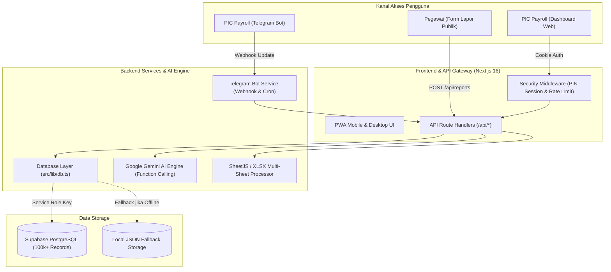

# DOKUMENTASI SISTEM APLIKASI
# ASISTEN INTELIJEN PAYROLL & LAYANAN PEGAWAI
**PT Pelindo Daya Sejahtera (PDS)**

---

## 1. PENDAHULUAN & MAKSUD TUJUAN

### 1.1 Latar Belakang Masalah
PT Pelindo Daya Sejahtera (PDS) mengelola administrasi penggajian (*payroll*) bagi lebih dari **17.000 tenaga kerja** yang tersebar di berbagai unit kerja, terminal pelabuhan, dan proyek operasional di seluruh Indonesia (seperti Terminal Petikemas Surabaya, Koja, Kalibaru, Semarang, Belawan, dan unit pendukung lainnya).

Dalam proses operasional penggajian bulanan, tim PIC Payroll menghadapi sejumlah tantangan utama:
1. **Kompleksitas Komponen Penggajian**: Struktur penerimaan gaji terdiri dari upah pokok serta **lebih dari 92 jenis komponen tunjangan dan upah lembur dinamis** (insentif kehadiran, tunjangan shift, tunjangan risiko, tunjangan kemahalan, bantuan makan/transport, kompensasi cuti, dsb.) serta berbagai komponen potongan (BPJS Ketenagakerjaan & Kesehatan, TGR/tuntutan ganti rugi, pinjaman koperasi, PPh 21).
2. **Lonjakan Pertanyaan Berulang Menjelang Cut-Off & Hari Pembayaran Gaji**: Setiap tanggal cut-off pengerjaan gaji (**tanggal 23**) dan tanggal pembayaran gaji (**tanggal 25**), tim PIC dibanjiri pertanyaan pegawai mengenai rincian slip gaji, perbedaan nominal Take Home Pay (THP) dibandingkan bulan lalu, atau kejelasan perhitungan lembur.
3. **Pencatatan Tiket Kendala Tercecer**: Keluhan pegawai yang disampaikan melalui chat pribadi sering kali tidak terdokumentasi dengan baik, berisiko terlewat dari target penyelesaian (*overdue*), dan sulit dievaluasi status tindak lanjutnya sebelum tanggal cut-off.
4. **Keterbatasan Kapasitas ERP saat Unggah Data**: File rekapitulasi data dari sistem utama sering kali terlalu besar untuk diproses sekaligus, membutuhkan pemecahan file manual per 1.000 baris dengan mempertahankan format header dan formula.
5. **Kebutuhan Komparasi Beban Gaji untuk Rapat Manajemen**: Pimpinan membutuhkan gambaran cepat perbandingan beban payroll perusahaan antar-bulan beserta faktor pendorong kenaikan/penurunan biaya tanpa harus menunggu olah data manual berjam-jam.

### 1.2 Maksud & Tujuan Pengembangan Aplikasi
Aplikasi **Asisten Intelijen Payroll** dirancang sebagai solusi sentral berbasis web dan bot perpesanan cerdas dengan tujuan:
- **Meningkatkan Efisiensi & Kecepatan Kerja PIC**: Mengotomasi pencarian data gaji, perbandingan multi-bulan, dan kalkulasi selisih secara instan (<5 milidetik) dari ratusan ribu baris data historis.
- **Transparansi & Kemudahan Layanan Pegawai**: Menyediakan portal lapor kendala mandiri publik yang mudah diakses pegawai via ponsel cerdas (PWA) tanpa perlu login rumit, dengan sistem penomoran tiket otomatis.
- **Asisten AI Siaga 24/7**: Memanfaatkan integrasi **Telegram Bot** dan **Google Gemini AI** untuk menjawab konsultasi payroll kapan saja menggunakan bahasa percakapan sehari-hari.
- **Monitoring & Anti-Lupa Deadline**: Memberikan pengingat berkala (*Daily Briefing*) dan penanda visual tegas (*Overdue Alert*) terhadap tiket maupun to-do list yang mendekati tanggal cut-off (tanggal 23) atau melewati batas waktu (*due date*).
- **Keamanan Data Ekstra**: Memastikan rincian finansial pegawai terlindungi melalui autentikasi PIN, isolasi jaringan, sanitasi data publik, dan keamanan berbasis *Row Level Security*.

---

## 2. ARSITEKTUR TEKNOLOGI & INFRASTRUKTUR

Aplikasi dibangun menggunakan arsitektur modern berkinerja tinggi:



### Rincian Stack Teknologi:
- **Framework Utama**: Next.js 16 (App Router, Turbopack, React 19)
- **Bahasa Pemrograman**: TypeScript (Strict Type Safety)
- **Desain Antarmuka**: Tailwind CSS, Lucide Icons, Canvas Confetti
- **Basis Data Utama**: Supabase (PostgreSQL Terkelola dengan B-Tree Indexing pada kolom periode, NRP, dan nama)
- **Mesin AI**: Google Gemini API SDK (`@google/genai`) dengan arsitektur *Tool Execution / Function Calling*
- **Mesin Video Motion Graphics**: Remotion (`remotion`, `@remotion/player`)
- **Manipulasi Spreadsheet**: SheetJS (`xlsx`) & JSZip
- **Otomasi Notifikasi**: Telegram Bot API & Vercel Cron Jobs

---

## 3. FITUR UTAMA APLIKASI

### 3.1 Dashboard Eksekutif & Daily Briefing
Halaman utama yang digunakan PIC Payroll sehari-hari untuk memantau ritme kerja penggajian:
- **Kartu Daily Briefing Cerdas**:
  - **Penghitung Mundur Cut-Off Payroll (Tanggal 23)**: Menghitung mundur sisa hari menuju batas akhir cut-off pengerjaan gaji setiap bulannya.
  - **Notifikasi Hari Pembayaran Gaji (Tanggal 25)**: Status pengingat khusus bahwa hari ini adalah hari pembayaran gaji dan waktu mengunggah rekapitulasi data ERP ke sistem.
  - **Banner Peringatan Keterlambatan (*Overdue Alert*)**: Otomatis mendeteksi dan memberi *highlight* mencolok warna merah menyala jika terdapat to-do list atau tiket kendala yang telah melewati target tanggal jatuh tempo (`dueDate < hari ini`), lengkap dengan tombol navigasi 1-klik untuk menyelesaikan tugas terkait.
  - Daftar agenda kerja yang jatuh tempo *Hari Ini* dan *Besok*.
- **Kartu Metrik Tiket Interaktif**:
  - Pemantauan jumlah laporan dengan status **Open** (Baru), **Crosscheck** (Sedang Konfirmasi), dan **Close** (Selesai).
  - Indikator tiket berprioritas **Urgent**.
  - Mini alert bar di bawah kartu dengan tombol filter langsung ke laporan atau to-do yang terlambat.
- **Pencarian & Multi-Filter Laporan**:
  - Kotak pencarian responsif untuk mencari berdasarkan Nama Pegawai, NRP, No. Tiket, Unit/Project, maupun Nama Pelapor.
  - Filter dropdown berdasarkan Periode Penggajian, Kategori Kendala, dan Status Tiket (termasuk filter khusus `🔴 Terlambat`).
- **Paginasi Cerdas**: Navigasi data 10, 25, 50, atau 100 baris per halaman.

---

### 3.2 Modul To-Do List Pribadi Asisten
Tab khusus di samping daftar laporan untuk mengelola tugas internal PIC:
- Penambahan agenda tugas dengan judul, tingkat urgensi (*Rendah, Sedang, Tinggi, Urgent*), dan target tanggal jatuh tempo (*Due Date*).
- Filter status cepat: **Semua**, **Aktif**, **Selesai**, **🔴 Terlambat**, dan **⚡ Hari Ini**.
- Penanda visual tegas (bingkai merah lembut dan badge `TERLAMBAT`) pada tugas yang lewat batas waktu.
- Sinkronisasi langsung dengan notifikasi pengingat harian Telegram.

---

### 3.3 Formulir Lapor Kendala Pegawai Mandiri (`/lapor`)
Portal publik mandiri untuk karyawan PDS:
- **Desain Ramah Ponsel (PWA)**: Dapat dibuka di browser smartphone maupun ditambahkan ke layar utama (*Add to Home Screen*).
- **Auto-Fill Data Pegawai Terproteksi**: Saat pegawai mengetikkan NRP atau namanya, sistem secara otomatis membantu mengisi Unit Kerja dan Jabatan. Sistem menerapkan sanitasi data ketat sehingga data nominal rupiah gaji tidak pernah dibocorkan ke publik.
- **Kategori Kendala Terstandar**:
  1. *Lembur*: Selisih jam lembur, perhitungan upah lembur libur/hari kerja.
  2. *Potongan*: Potongan BPJS Ketenagakerjaan/Kesehatan, TGR, koperasi, dsb.
  3. *Tunjangan*: Tunjangan makan, transport, shift, kehadiran, kompensasi.
  4. *Jam Kerja / Presensi*: Kendala fingerprint, absensi dinas luar, cuti.
  5. *Upah Pokok*: Penyesuaian gaji pokok, masa kerja.
  6. *Nomor Rekening / Bank*: Perubahan data rekening bank penerima.
  7. *Lain-lain*: Pertanyaan administratif lainnya.
- **Generasi Nomor Tiket Otomatis**: Menghasilkan nomor tiket unik format resmi (misal: `#PDS-202610-001`).
- **Notifikasi Instan ke Telegram PIC**: Setiap tiket baru yang masuk otomatis memicu pesan alert ke akun Telegram PIC Payroll secara *real-time*.

---

### 3.4 Modul Data & Komparasi Payroll 100.000+ Pegawai
Pusat analitik hasil penggajian dari file master HRIS:
- **Pencarian Kilat 17.000+ Pegawai**: Menampilkan data gaji lengkap berdasarkan NRP, Nama, atau Unit Kerja dengan waktu respons di bawah 5 milidetik.
- **Rincian Slip Gaji Komprehensif**: Menampilkan Upah Pokok, Total Penerimaan, Jumlah Kotor (Bruto), Total Seluruh Potongan, dan Take Home Pay (THP), serta **rincian dinamis dari 92 jenis tunjangan dan potongan spesifik**.
- **Komparasi Multi-Bulan Pegawai**:
  - Membandingkan penerimaan seorang pegawai antara bulan berjalan dengan bulan sebelumnya.
  - Menghitung otomatis selisih THP (naik/turun/tetap).
  - *Drill-down*: Menunjukkan komponen tunjangan atau potongan mana saja yang mengalami kenaikan atau penurunan beserta nilai selisihnya.
- **Komparasi Makro Perusahaan (Rapat Direksi)**:
  - Analisis agregat dua periode penggajian: total jumlah pegawai, total upah pokok, total tunjangan, total lembur, total potongan, dan total beban pengeluaran THP perusahaan.
  - Membantu PIC menyajikan data evaluasi anggaran penggajian kepada manajemen dengan cepat.
- **Fitur Ekspor Master Excel Multi-Bulan (Per-Sheet)**:
  - Mengunduh rekapitulasi gaji multi-bulan di mana **setiap bulan otomatis ditempatkan pada sheet tersendiri** (misal: sheet `Mei 2026`, `Juni 2026`, dst.).
  - Setiap baris pegawai memuat rincian lengkap 92 kolom tunjangan dan potongan yang presisi sesuai file sumber ERP.
- **Fitur Ekspor Akumulasi YTD (Year-To-Date)**:
  - Mengunduh rekap riwayat penerimaan kumulatif seorang pegawai selama 1 tahun berjalan untuk keperluan audit, bukti potong pajak, atau evaluasi kerja.

---

### 3.5 Alat Bantu Operasional Payroll (Payroll Toolkit)
1. **Pemecah Excel HRIS (`/tools/excel-splitter`)**:
   - Memecah file master Excel payroll berukuran puluhan ribu baris menjadi beberapa pecahan file berukuran maksimal 1.000 baris.
   - Tetap mempertahankan baris header, format sel, dan rumus kalkulasi tanpa merusak integritas file.
   - Hasil pecahan otomatis dikemas rapi dalam 1 file arsip `.zip`.
2. **Kalkulator Terbilang Nota Dinas**:
   - Mengonversi nominal angka rupiah (misal: `Rp 14.820.450.000`) menjadi kalimat ejaan resmi bahasa Indonesia sesuai kaidah tata naskah dinas kedinasan.
   - Tombol 1-klik salin ke clipboard untuk mempercepat penyusunan Nota Dinas usulan penggajian ke direksi.
3. **Video Showcase Studio Remotion (`/tools/video-showcase`)**:
   - Studio animasi interaktif penjelas aplikasi berbasis kode React (Remotion).
   - Mendukung peralihan dinamis antara rasio **Landscape 16:9** (presentasi) dan **Portrait 9:16** (story/reels ponsel).
   - Animasi dinamis maskot PDS, kartu komparasi data, counter angka THP, dan simulasi Telegram Bot.

---

### 3.6 Bot Telegram Asisten & AI 24/7
Bot terhubung melalui webhook resmi (`@AssistenPampamBot`) yang melayani PIC Payroll secara interaktif:

| Perintah Bot | Fungsi & Output |
| :--- | :--- |
| `/cek [NRP/Nama]` | Menampilkan rincian lengkap Upah Pokok, Lembur, Tunjangan, Potongan, dan THP pegawai terkait. |
| `/banding [NRP]` | Komparasi rincian gaji pegawai bulan ini vs bulan lalu (selisih THP & komponen pemicu perubahan). |
| `/bandingtotal [Bln1] [Bln2]` | Analisis komparasi makro beban payroll perusahaan antar-dua bulan untuk bahan rapat direksi. |
| `/total [Periode]` | Rekapitulasi eksekutif total pegawai dibayar dan beban THP perusahaan pada bulan terkait. |
| `/tiket` atau `/rekap` | Ringkasan jumlah tiket kendala (Open, Crosscheck, Close) dan status keterlambatan target. |
| `/todo` | Daftar agenda to-do list aktif dengan peringatan khusus untuk tugas yang terlambat deadline. |
| *Chat Bahasa Alami* | Tanya bebas tanpa awalan garis miring (`/`), dijawab secara cerdas oleh Google Gemini AI (misal: *"Berapa lembur mas Budi di project Koja?"*). |

#### Notifikasi Terjadwal Otomatis (Cron Jobs):
- **Daily Briefing Harian Pagi (Pukul 07.00 WIB)**:
  Mengirimkan rekap hari, hitung mundur cut-off pengerjaan gaji tanggal 23, status tiket laporan, peringatan to-do list terlambat, dan daftar tugas hari ini langsung ke Telegram PIC.
- **Pengingat Hari Pembayaran Gaji Tanggal 25 (Pukul 08.00 WIB)**:
  Mengingatkan PIC bahwa hari ini adalah tanggal 25 (hari pembayaran gaji), saatnya mengunduh dan mengunggah rekapitulasi hasil penggajian dari ERP ke aplikasi asisten agar layanan bot dan komparasi siap digunakan.

---

## 4. CARA KERJA & ALUR OPERASIONAL SISTEM (WORKFLOW)

### 4.1 Siklus Penggajian Bulanan (Monthly Payroll Lifecycle)

```
[ Tanggal 1 - 22 ] ➔ Periode Berjalan & Penanganan Kendala
Pegawai mengajukan kendala absensi/lembur via form /lapor.
PIC menindaklanjuti tiket (Open ➔ Crosscheck ➔ Close) dipandu To-Do List & reminder.
                          │
                          ▼
[ Tanggal 23 ] ➔ Cut-Off Pengerjaan Gaji
Countdown cut-off mencapai 0 hari (Batas akhir pengerjaan).
Seluruh data presensi dan tiket kendala dipastikan tuntas (Close).
PIC menyelesaikan rekonsiliasi akhir dan perhitungan payroll untuk proses transfer.
                          │
                          ▼
[ Tanggal 25 ] ➔ Hari Pembayaran Gaji & Unggah Data Payroll ERP
Gaji resmi dibayarkan kepada seluruh pegawai PT Pelindo Daya Sejahtera.
Bot Telegram mengirimkan notifikasi pengingat tanggal 25 pagi.
PIC mengunduh file rekap hasil payroll dari ERP kantor.
Jika file terlalu besar, PIC memecah file via Pemecah Excel HRIS (/tools/excel-splitter).
PIC mengunggah file Excel ke dashboard menu "Data Payroll".
                          │
                          ▼
[ Pasca Tanggal 25 ] ➔ Analisis, Komparasi, & Layanan Pertanyaan
PIC memverifikasi komparasi makro untuk evaluasi anggaran direksi.
Bot Telegram & AI siap melayani pengecekan slip gaji ribuan pegawai secara instan.
```

### 4.2 Alur Penanganan Tiket Kendala Pegawai
1. **Pengajuan**: Pegawai membuka URL `/lapor`, memasukkan NRP, memilih kategori kendala, mengisi kronologi masalah, dan mengirimkan tiket sebelum tanggal cut-off (tanggal 23).
2. **Notifikasi Instan**: Sistem menyimpan laporan ke Supabase dan secara instan mengirim notifikasi tiket baru ke Telegram PIC.
3. **Penyelidikan**: PIC membuka Dashboard, menyaring tiket, mengecek data historis payroll pegawai terkait, dan mengubah status menjadi **Crosscheck** saat mengonfirmasi ke tim lapangan/SDM.
4. **Penyelesaian**: Setelah koreksi disetujui, PIC mengisi catatan penyelesaian (*Resolution Note*) dan mengubah status menjadi **Close**.
5. **Pemantauan Keterlambatan**: Jika sebelum diselesaikan tanggal target telah terlewati, sistem secara otomatis menaikkan status tiket ke banner **Overdue Alert** di dashboard dan Telegram Daily Briefing.

---

## 5. SISTEM KEAMANAN & PRIVASI DATA

Data kompensasi pegawai merupakan informasi rahasia (*confidential*). Sistem mengadopsi standar keamanan berlapis:

1. **Proteksi Autentikasi PIN (6 Digit)**:
   - Dashboard utama hanya dapat diakses setelah memasukkan PIN yang benar.
   - Sesi terautentikasi disimpan dalam cookie `payroll_auth_session` dengan atribut `httpOnly: true` (kebal dari manipulasi skrip XSS) dan `SameSite: Lax`.
2. **Anti Brute-Force Rate Limiting**:
   - Endpoint autentikasi PIN (`/api/auth/pin`) diawasi oleh mekanisme rate limiter berbasis alamat IP.
   - Jika terjadi 5 kali kegagalan memasukkan PIN berturut-turut, akses ke endpoint tersebut otomatis dikunci (*lockout*) selama 5 menit.
3. **Pemberlakuan Ketat Middleware Gateway (`src/middleware.ts`)**:
   - Seluruh rute API internal (`/api/reports`, `/api/todos`, `/api/payroll-results/*`, `/api/settings`) wajib melewati verifikasi cookie sesi PIN.
4. **Sanitasi Data Endpoint Publik**:
   - Endpoint pencarian pegawai untuk formulir publik (`/api/payroll-results/query`) secara ketat menyaring output data: **hanya memunculkan Nama, NIK, Jabatan, dan Unit Kerja**. Seluruh nominal finansial (Gapok, Tunjangan, Potongan, THP) dipotong 100% dari payload JSON publik.
5. **Keamanan Basis Data Supabase (Row Level Security - RLS)**:
   - Akses Supabase dijalankan murni di sisi server (*server-side*) menggunakan `SUPABASE_SERVICE_ROLE_KEY`.
   - Kredensial tidak pernah disertakan dalam bundle JavaScript klien.
6. **Otorisasi Akun Telegram Ketat**:
   - Webhook Telegram mencocokkan `chat.id` pengirim dengan `TELEGRAM_CHAT_ID` resmi PIC. Setiap pesan dari pengguna luar langsung ditolak (`⛔ Akses Ditolak`).
7. **HTTP Security Headers**:
   - Konfigurasi `next.config.ts` menyertakan `X-Frame-Options: SAMEORIGIN` (mencegah *clickjacking*), `X-Content-Type-Options: nosniff`, dan `Referrer-Policy: strict-origin-when-cross-origin`.
8. **Kebijakan Git & Repositori Bersih**:
   - File `.gitignore` dikonfigurasi ketat mengabaikan file `.env*`, berkas Excel mentah (`*.xlsx`, `*.csv`), dan sertifikat kredensial sehingga tidak ada kebocoran rahasia ke repositori publik.

---

## 6. PANDUAN PENGOPERASIAN SINGKAT

### Akses Halaman Penting:
- **Dashboard PIC Utama**: `https://[domain-anda]/` (Memerlukan PIN)
- **Form Lapor Mandiri Pegawai**: `https://[domain-anda]/lapor` (Publik / Ramah Ponsel)
- **Pemecah File Excel HRIS**: `https://[domain-anda]/tools/excel-splitter`
- **Studio Video Motion Graphic**: `https://[domain-anda]/tools/video-showcase`

### Tombol Pintas & Operasional Harian:
1. **Salin Tautan Form Pegawai**: Klik ikon rantai di pojok kanan atas navbar untuk menyalin link `/lapor` yang siap dibagikan ke grup WhatsApp unit/pegawai.
2. **Kunci Layar Cepat**: Klik tombol gembok di navbar untuk mengakhiri sesi dan mengunci dashboard seketika.
3. **Ekspor Rekap Tiket**: Buka menu *Alat Bantu Payroll ➔ Unduh Rekap Tiket* untuk mendapatkan arsip Excel seluruh tiket kendala yang masuk.
4. **Cek Gaji via Ponsel**: Cukup buka Telegram dan ketik `/cek [NRP]` tanpa perlu menyalakan laptop.

---

*Dokumen ini disusun sebagai panduan resmi arsitektur, fitur, dan pengoperasian Sistem Asisten Intelijen Payroll PT Pelindo Daya Sejahtera.*
